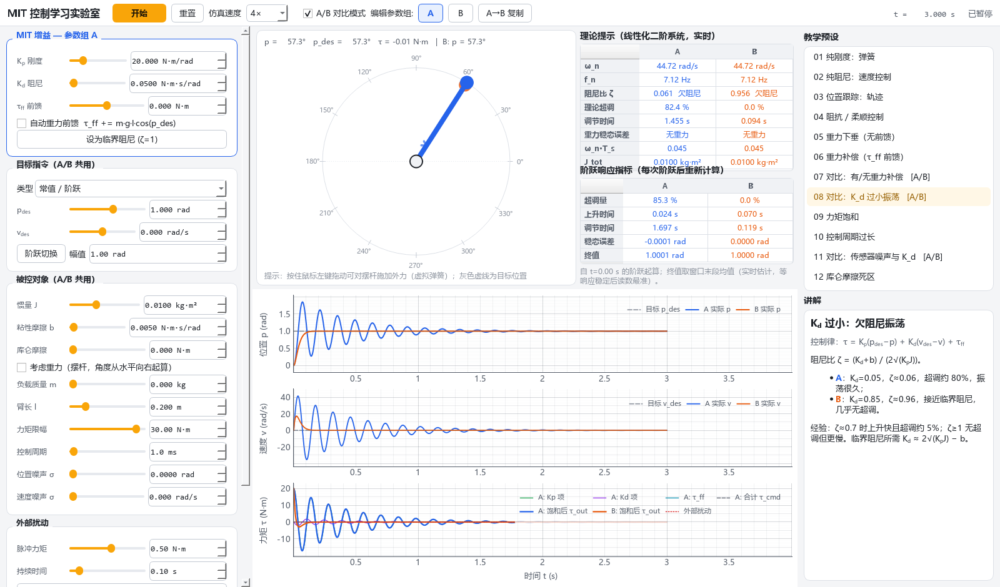

# MIT 控制学习实验室（MITControlLab）

一个用于**学习关节模组 MIT 控制模式**的中文可视化桌面工具。纯软件单关节物理仿真，实时调参、实时动画与曲线、自动计算阶跃响应指标，并内置 12 个带讲解的教学预设和 A/B 对比模式。

技术栈：Python 3.11（亦兼容 3.10+）· PySide6 · pyqtgraph · numpy；Windows / Linux 通用。纯软件仿真，无需真实硬件。



---

## 1. 理论基础

### 1.1 MIT 控制律

MIT 模式（源自 MIT Cheetah 的关节驱动器协议）每个控制周期接收 5 个量：`p_des, v_des, Kp, Kd, tau_ff`，在驱动器内部计算：

```
tau = Kp * (p_des - p) + Kd * (v_des - v) + tau_ff
```

| 量 | 物理含义 |
|---|---|
| `Kp` | 虚拟扭簧刚度（N·m/rad） |
| `Kd` | 虚拟阻尼（N·m·s/rad） |
| `p_des, v_des` | 弹簧/阻尼器的“另一端”的位置与速度 |
| `tau_ff` | 前馈力矩（重力补偿、动力学前馈、摩擦补偿……） |

所以 MIT 控制本质上是**阻抗控制**：关节表现得像“弹簧 + 阻尼器 + 外加力矩”。

* `Kp=0`：速度模式（阻尼器拖着走）；
* `Kp=Kd=0`：纯力矩模式；
* 低 `Kp`：柔顺 / 阻抗控制；高 `Kp`+合适 `Kd`：位置伺服。

### 1.2 被控对象（本软件的仿真模型）

```
J_tot * a = sat(tau) - b*v - tau_c*sign(v) - m*g*l*cos(p) + tau_ext
J_tot     = J + m*l^2
```

* 角度 `p` 从**水平向右**起算，逆时针为正；重力开启时 `p=0` 是摆杆水平、重力矩最大的位置。
* `sat()` 为力矩限幅；`tau_c` 为库仑摩擦（含静摩擦“粘住”效应，Karnopp 型处理）。
* 控制律按**控制周期 Ts 采样并零阶保持（ZOH）**，物理以 ≤1 ms 固定步长 **RK4** 积分（Ts 总是物理步长的整数倍）。
* 可选位置/速度传感器高斯噪声（只影响控制器“看到”的测量值）。

### 1.3 常用理论公式（界面右上实时显示）

线性化后（忽略重力、摩擦、饱和）就是标准二阶系统 `J s² + (Kd+b) s + Kp`：

| 公式 | 含义 |
|---|---|
| `ωn = √(Kp/J)` | 固有角频率：Kp 越大越“快” |
| `ζ = (Kd+b) / (2√(Kp·J))` | 阻尼比：<1 欠阻尼（超调振荡），=1 临界阻尼，>1 过阻尼 |
| `超调 = exp(−ζπ/√(1−ζ²))` | 只与 ζ 有关，ζ=0.7 时约 4.6% |
| `ts(2%) ≈ 4/(ζ·ωn)` | 调节时间 |
| `e_ss ≈ m·g·l·cos(p_des)/Kp` | 重力导致的稳态误差（无 τ_ff 时） |
| `Kd_crit = 2√(Kp·J) − b` | 临界阻尼所需 Kd（面板上“设为临界阻尼”按钮） |
| `ωn·Ts` | 离散化程度，>0.2 时采样保持的延迟会明显吃掉阻尼 |

### 1.4 阶跃响应指标（界面自动计算）

每次阶跃（修改 `p_des`、点“阶跃切换”、重置）后重新计算：

* **超调量** = (峰值 − 终值) / |终值 − 初值| × 100%
* **上升时间**：10% → 90%
* **调节时间**：最后一次离开 ±2% 误差带之后的时刻（相对阶跃时刻）
* **稳态误差** = p_des − 终值；终值取窗口末段均值（响应稳定后读数最准）

---

## 2. 运行方法

### Windows（一键）

双击 **`run_windows.bat`**：
1. 若 `.venv` 不存在，用 `py -3.11` / `py -3` / `python` 创建虚拟环境；
2. 若依赖缺失则 `pip install -r requirements.txt`（默认源失败时自动改用清华镜像 `https://pypi.tuna.tsinghua.edu.cn/simple`）；
3. 启动程序（`pythonw`，无控制台窗口）。

手动方式：
```bat
py -3.11 -m venv .venv
.venv\Scripts\python -m pip install -r requirements.txt
.venv\Scripts\python run.py
```

### Linux（一键）

```bash
./run_linux.sh
```
Debian/Ubuntu 若缺 Qt 运行库或中文字体：
```bash
sudo apt install python3-venv libegl1 libgl1 libxkbcommon-x11-0 libxcb-cursor0 fonts-noto-cjk
```

### 命令行参数

```
python run.py [--preset KEY] [--size 1600x940] [--smoke MS] [--screenshot FILE]
```
`KEY` 可选：`spring damping tracking impedance gravity_sag gravity_ff gravity_ab kd_small saturation period noise coulomb`。

### 测试

```bat
run_tests.bat                    (Windows)
QT_QPA_PLATFORM=offscreen .venv/bin/python -m pytest -v   (Linux)
```
测试包括仿真核心（固有频率、阻尼比/超调、速度模式、重力稳态误差与补偿、饱和、ZOH、扰动、库仑死区）、指标算法、目标轨迹，以及离屏 UI 冒烟测试（逐个运行预设、切换对比模式、各种目标与交互），并把截图保存到 `docs/screenshot.png`。

### 打包（可选，PyInstaller）

```bat
packaging\build_windows.bat      → dist\MITControlLab\MITControlLab.exe
packaging/build_linux.sh         → dist/MITControlLab/MITControlLab + tar.gz
```

---

## 3. 功能概览

**参数调节（左侧，滑块与数值框双向同步）**
* MIT 增益（按参数组 A/B 分别保存）：Kp、Kd、τ_ff、自动重力前馈、一键临界阻尼；
* 目标指令（A/B 共用）：常值/阶跃（含“阶跃切换”按钮）、正弦（幅值/频率）、轨迹序列（min-jerk / 梯形 / 三角，幅值/运动时间/停留时间），可选“v_des 取轨迹导数”；
* 被控对象（A/B 共用）：惯量 J、粘性摩擦 b、库仑摩擦、负载质量 m / 臂长 l、重力开关、力矩限幅、控制周期（0.5–50 ms）、位置/速度噪声；
* 外部扰动：力矩脉冲按钮（幅值/持续时间），或**鼠标直接拖拽摆杆**（虚拟弹簧，刚度可调）。

**仿真**：开始 / 暂停 / 重置，仿真速度 0.1×–4×。

**可视化（中间）**
* 关节动画：实际摆杆（A 蓝 / B 橙）、目标“幽灵”摆杆（灰虚线）、关节输出力矩弧形箭头、重力箭头、拖拽弹簧；
* 实时曲线（时间窗口可调，x 轴联动）：位置（实际 vs 目标）、速度（实际 vs 目标）、力矩分量（Kp 项、Kd 项、τ_ff、合计 τ_cmd、饱和后 τ_out、外部扰动，以及 ±限幅线）。点击图例可隐藏/显示曲线；
* 理论提示表（ωn、fn、ζ、理论超调、调节时间、重力稳态误差、ωn·Ts、J_tot）与阶跃指标表，A/B 两列。

**A/B 对比模式**：两组 MIT 增益在完全相同的被控对象、目标、扰动和噪声序列下同步运行，曲线叠加、动画中两根摆杆不同颜色。

---

## 4. 教学预设（右侧，带中文讲解）

| # | 预设 | 学什么 |
|---|---|---|
| 01 | 纯刚度：弹簧 | Kd=0，几乎无阻尼持续振荡；周期 = 2π/√(Kp/J) |
| 02 | 纯阻尼：速度控制 | Kp=0，v_des 速度模式；稳态速度 Kd·v_des/(Kd+b) |
| 03 | 位置跟踪：轨迹 | min-jerk 往返轨迹 + 速度前馈，ζ≈0.9 |
| 04 | 阻抗 / 柔顺控制 | 低 Kp，按钮扰动或鼠标拖拽，偏移 ≈ τ_ext/Kp |
| 05 | 重力下垂（无前馈） | 稳态误差 ≈ mgl·cos(p)/Kp ≈ 5.6° |
| 06 | 重力补偿（τ_ff 前馈） | τ_ff = mgl·cos(p_des)，误差 → 0 |
| 07 | 对比：有/无重力补偿 [A/B] | 两根摆杆一垂一平 |
| 08 | 对比：Kd 过小振荡 [A/B] | ζ≈0.06 vs ζ≈0.96 |
| 09 | 力矩饱和 | τ_cmd ≫ τ_out，响应变慢并产生超调 |
| 10 | 控制周期过长 | Ts=15 ms 时实际超调明显大于连续理论 |
| 11 | 对比：传感器噪声与 Kd [A/B] | Kd 放大速度噪声 → 力矩毛刺 |
| 12 | 库仑摩擦死区 | 停在 |e| ≤ τ_c/Kp 的死区内 |

---

## 5. 目录结构

```
MITControlLab/
├─ mitlab/              # 纯 Python 仿真核心（不依赖 Qt，可单独测试）
│  ├─ sim.py            #   被控对象、MIT 控制律、ZOH + RK4 仿真器、理论公式
│  ├─ targets.py        #   目标生成：常值 / 正弦 / min-jerk / 梯形 / 三角
│  ├─ metrics.py        #   阶跃响应指标 + 标准二阶响应
│  ├─ presets.py        #   12 个教学预设及中文讲解
│  └─ buffer.py         #   绘图用滚动缓冲
├─ ui/                  # PySide6 + pyqtgraph 界面
│  ├─ app.py            #   入口、字体、截图
│  ├─ main_window.py    #   主窗口
│  ├─ arm_view.py       #   摆杆动画 + 鼠标拖拽
│  ├─ widgets.py        #   滑块+数值框联动控件
│  └─ theme.py          #   配色与 QSS
├─ tests/               # pytest（核心 + 离屏 UI 冒烟）
├─ packaging/           # PyInstaller spec 与构建脚本
├─ docs/screenshot.png
├─ run.py  run_windows.bat  run_linux.sh  run_tests.bat
└─ requirements.txt  requirements-dev.txt
```

## 6. 已知局限

* 单关节、刚性连杆、点质量负载；未建模电机电气动态（电流环带宽）、减速器背隙/柔性、编码器量化。
* 速度测量是“真实速度 + 高斯噪声”，未模拟差分测速与滤波。
* 阶跃指标的“终值”取当前窗口末段均值，响应仍在振荡时只是实时估计；正弦/轨迹目标下不计算阶跃指标。
* 鼠标拖拽通过虚拟弹簧施力，力的大小与拖拽刚度有关，不代表真实手感。
* 实时运行依赖 Python 计算，1 ms 物理步长下 4× 速度 + 对比模式仍很轻松，但极小控制周期（0.5 ms）配合高倍速时 CPU 占用会升高。
